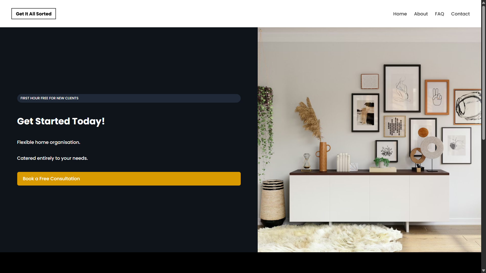

# Get It All Sorted

Marketing website for **Get It All Sorted**, a home-organisation business, built as a paid freelance project: a lightweight, fast, mobile-friendly site that keeps the look of the business's previous website.



## Pages

- **Home**: hero with call to action, before-and-after gallery of client spaces, social links
- **About**: the organiser's background and approach
- **FAQ**: common questions about bookings and services
- **Contact**: email link and a contact form that opens the visitor's email app with their message pre-filled

## Tech

Plain HTML, CSS and JavaScript with no framework or build step. The layout is responsive, with a breakpoint for tablet and mobile widths.

## Running Locally

Open `index.html` in a browser, or serve the folder:

```bash
python3 -m http.server 8000
```

## Structure

```text
index.html, about.html, faq.html, contact.html
style.css     Shared styles and responsive rules
script.js     Contact form handler
images/       Hero, portrait and before/after photos
```
